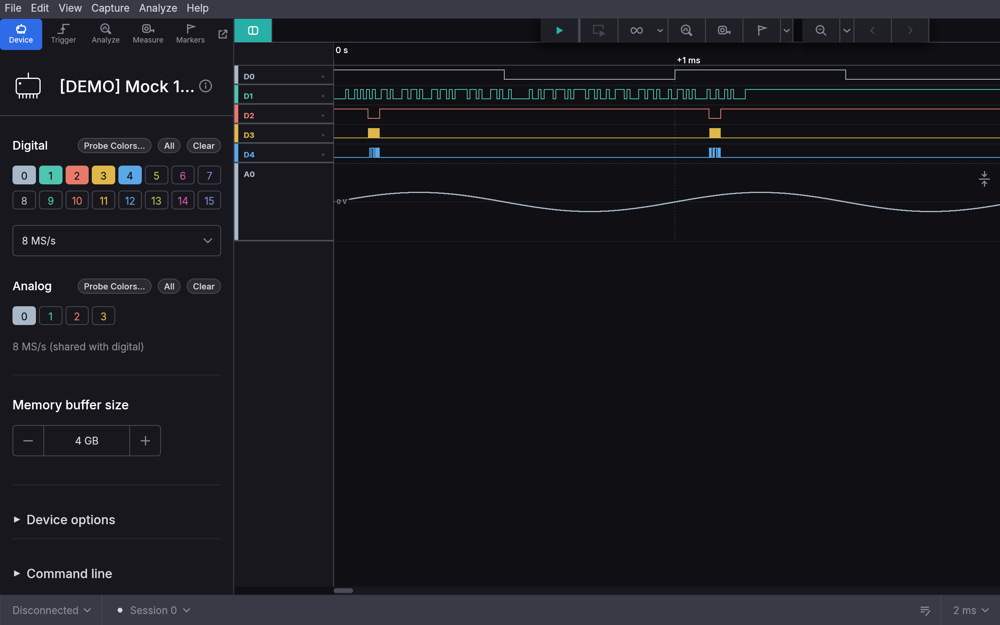
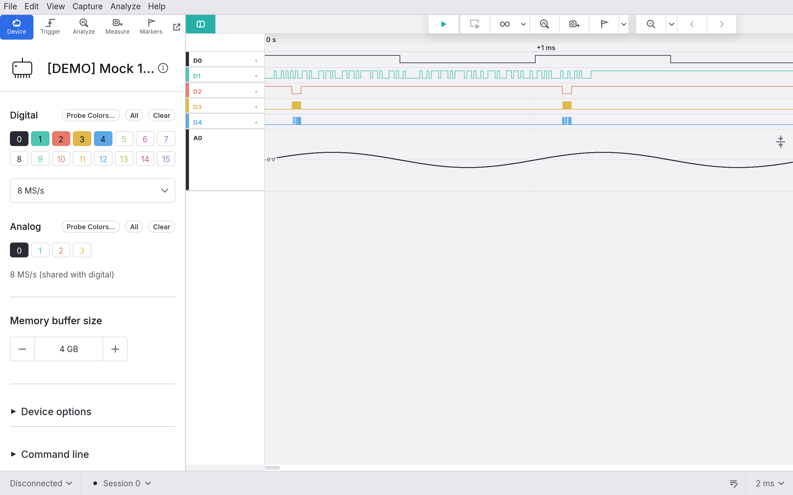
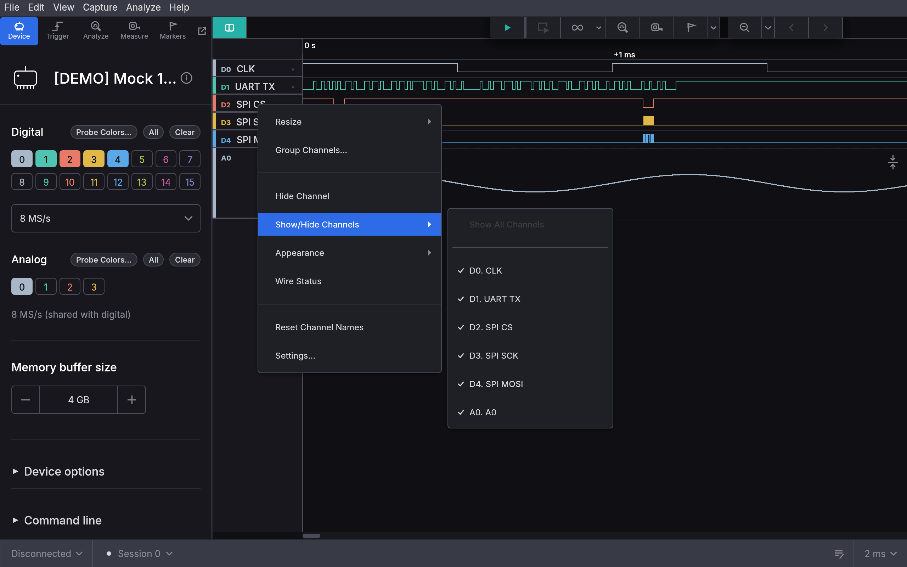
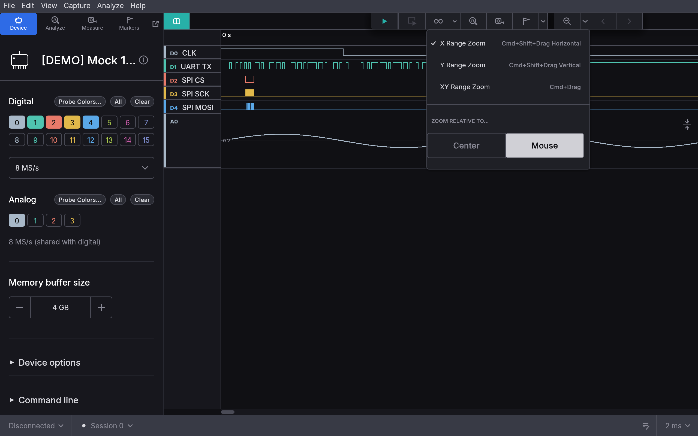
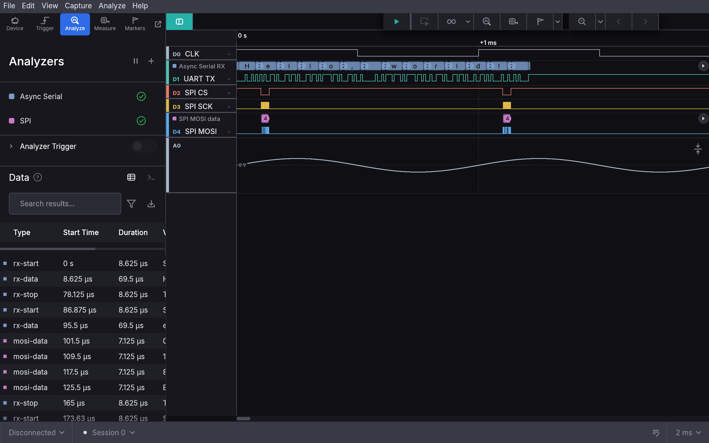
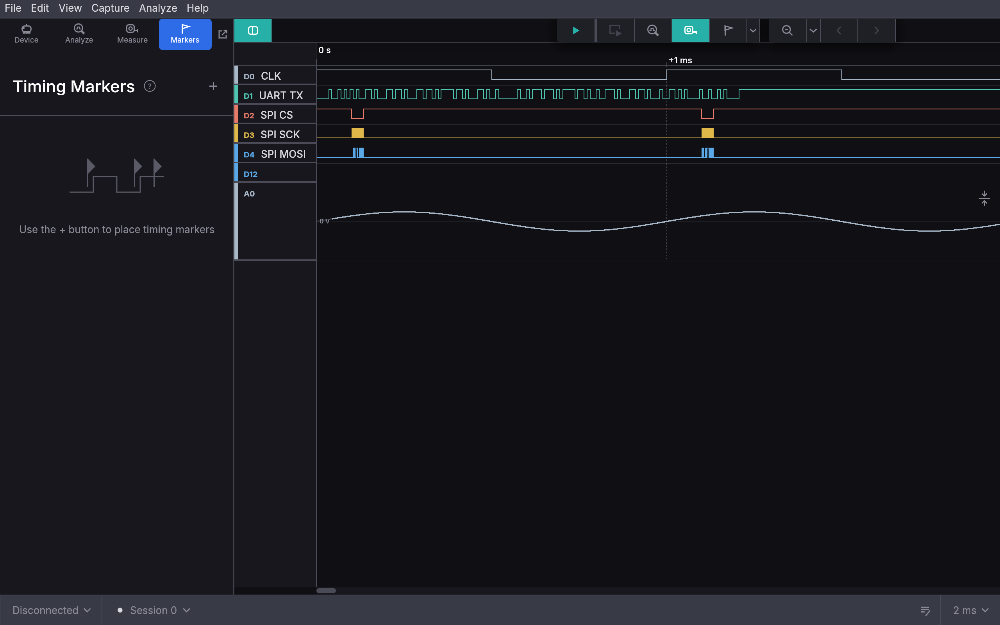
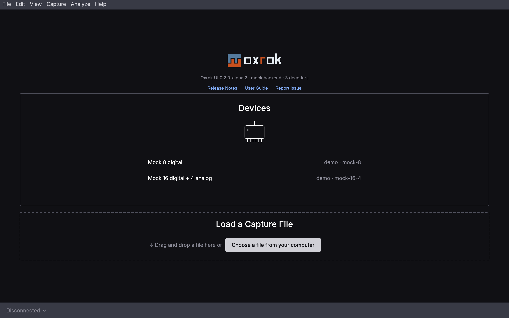

# Oxrok UI

A Rust/egui frontend for
[oxrok](https://github.com/oxrok/oxrok): the capture, display,
measurement and decoding UI for oxrok devices. Version `0.3.0-alpha.1`,
built on oxrok `0.3.0-alpha.1`.

## Install

```sh
cargo install --locked oxrok-ui --version 0.3.0-alpha.1
```

To try it without hardware, install with the built-in mock devices:

```sh
cargo install --locked --features mock oxrok-ui --version 0.3.0-alpha.1
```

`--locked` builds with the tested dependency versions; without it, a
newer transitive dependency of RustPython breaks the build. `--version`
picks this prerelease; without it cargo installs `0.2.0`, the stable one.

Prebuilt binaries for macOS, Linux and Windows: see [Packages](#packages).

## Screenshots

The capture view, zoomed to a 2 ms window:



The same in the light theme (View → Theme):



The row context menu, with inline-renamed rows:



The zoom tool: range zoom modes and *Zoom relative to*:



Protocol analyzers: bubbles above their channels and the searchable data
table:



A marker pair, a range measurement with its metrics popup, and the Timing
Markers panel:



The start screen:



Regenerate the screenshots with
`cargo test --test screenshots -- --ignored`.

## Layout

One crate, the modules bottom-up:

| Module | Content |
|---|---|
| `core` | Time, formatting, ticks, view state and animator, clock. No egui, no FFI. |
| `store` | Digital transition store, column classification, logic unpacking. |
| `backend` | The backend contract and the `MockBackend` (the `mock` feature). |
| `file` | The `.oxrok` capture container, import and export. |
| `engine` | Measurements, triggers, navigation, export. |
| `decode` | The decoder engine contract, the frame store, the mock decoders. |
| `oxrok` | `OxrokBackend` (devices and files) and the decoder engine, over oxrok. |
| `ui` | Theme, fonts, widgets, widget gallery. Depends on the backend contract only. |
| `app` | The eframe binary and `LaApp`. |
| `hil` | Hardware-in-the-loop test support. |

## Build and test

```sh
cargo run                            # with oxrok devices and decoders
cargo run --features macos-menu      # macOS: the native menu bar instead of the in-window one
cargo run --features mock            # with the built-in mock devices
cargo test --features mock           # everything that needs no hardware
cargo test --test oxrok_demo         # app ↔ oxrok end to end
```

RustPython is built into the binary, so no Python and no C sigrok library
are needed at build or run time. The app prints the oxrok version it uses
at startup.

```sh
make oxrok-info                    # the oxrok version and the decoders found
make oxrok-scan                    # its drivers and the devices it finds
make run                           # the app on oxrok (release; PROFILE=dev for debug)
```

## Packages

- **macOS:** `make firmware-deps` once, then `make bundle` writes an
  ad-hoc signed `Oxrok.app` and a `.dmg` to `dist/`.
  - It carries the Python decoders and the open firmware (oxrok and
    RustPython are in the binary).
  - The `.dmg` opens on the app beside a link to Applications, to drag
    it there. Finder lays that window out, so `make bundle` needs a
    logged-in desktop. Its background is
    `packaging/macos/dmg/background.svg` (`make dmg-background` renders
    it).
  - It ends with the app's `--self-test`.
  - For a release, `SIGN_IDENTITY` (a Developer ID Application identity)
    signs it with the hardened runtime, and `NOTARY_PROFILE` (a keychain
    profile of `xcrun notarytool store-credentials`) has Apple notarize
    the app and the `.dmg`.
- **Linux and Windows:** `packaging/linux/appimage.sh` (AppImage) and
  `packaging/windows/build.sh` (MSYS2 + Inno Setup).
- **CI:** the *Package* workflow (Actions → Package → Run workflow)
  builds all three, runs `--self-test` on each and uploads them.
  - The macOS `.dmg` is signed with the Developer ID certificate and
    notarized, in a job of its own that holds the keys.

## Using it

- Open a device: the start screen, or the **Devices** menu → *New Session*
- Record: `Space`; *Timed* mode stops by itself
- Zoom / pan: wheel, drag, `=`/`-`, the zoom tool
- Markers and measurements: `M`, `Shift+M`, `R`
- Decode a protocol: the toolbar hexagon or the Analyzers panel
- Save / open: `Ctrl/Cmd+S` / `Ctrl/Cmd+O` (`.oxrok`)
- Firmware a device is missing: the **Devices** menu → *Install…*
  downloads it from the vendor, or takes it from the vendor's software
  if you have it
- All shortcuts: `?` (with search); any command: `Ctrl/Cmd+K`

To update UI snapshots, run `UPDATE_SNAPSHOTS=1 cargo test --features mock`.

## License

GPL-3.0-or-later (see [`LICENSE`](LICENSE)), matching oxrok, which ports
the GPL sigrok code.

Bundled fonts keep their own license, the SIL Open Font License 1.1:
Inter, JetBrains Mono and subsets of Noto Sans SC (for Chinese; `make
cjk-font` rebuilds them), under `assets/fonts/`.
